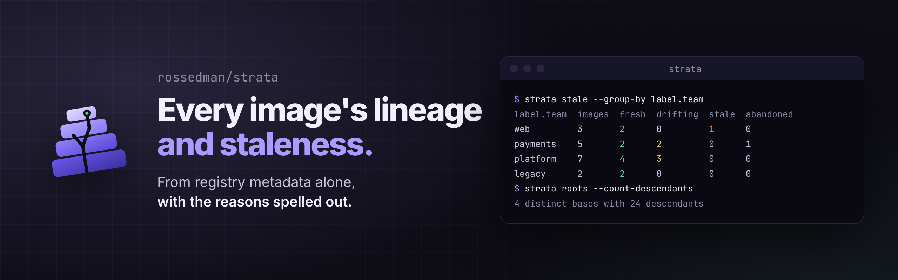
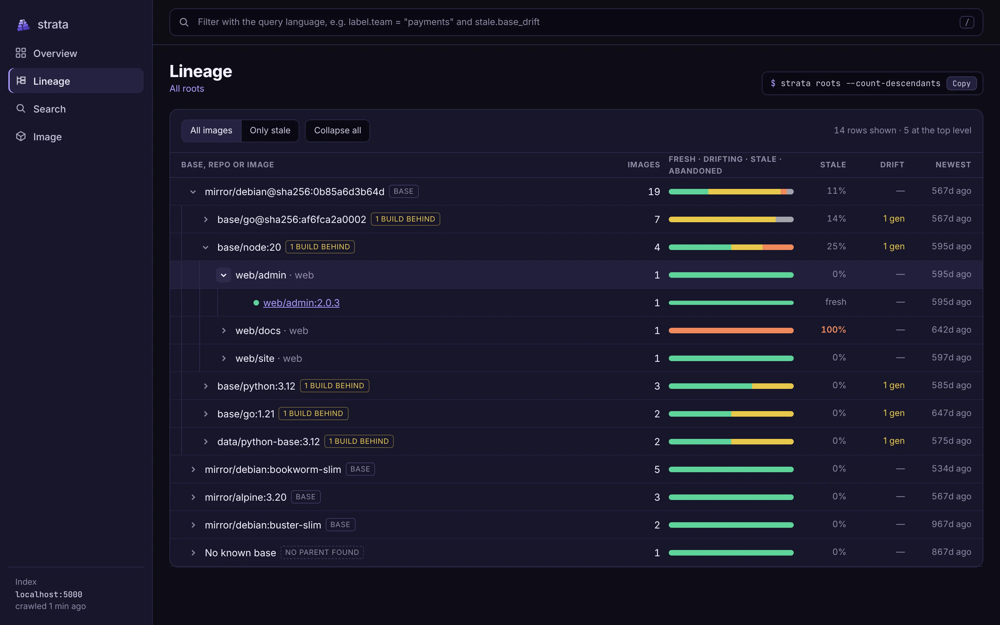
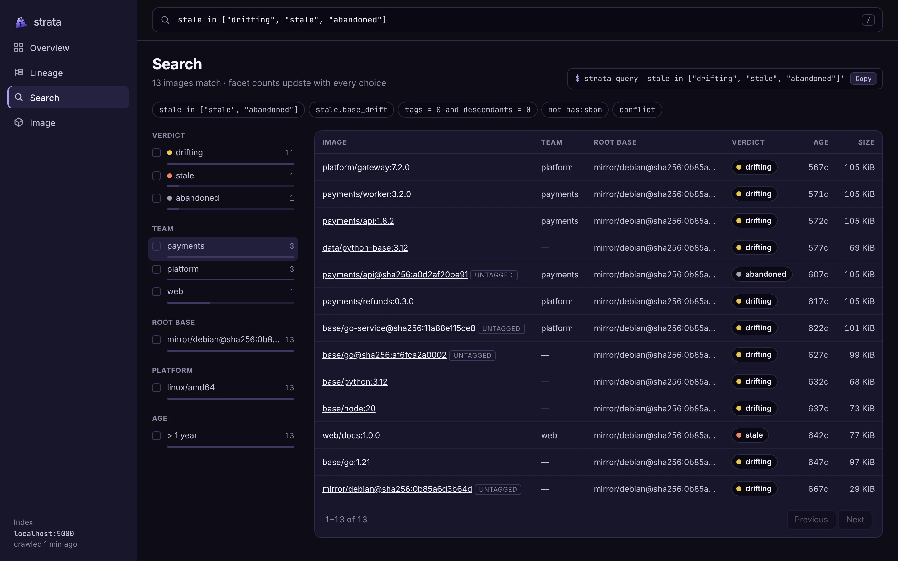
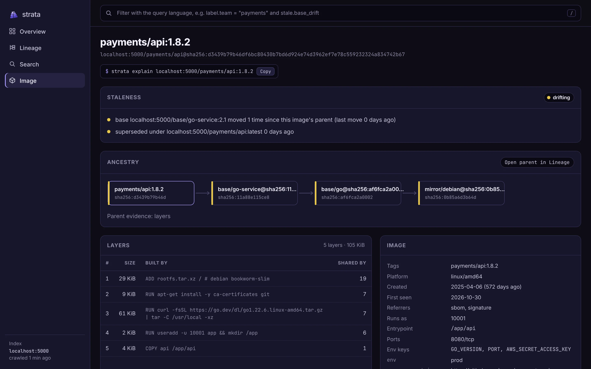

<p align="center"></p>

<p align="center">
  <a href="https://github.com/rossedman/strata/actions/workflows/ci.yml"></a>
  <a href="https://github.com/rossedman/strata/actions/workflows/ci.yml"></a>
  <a href="https://goreportcard.com/report/github.com/rossedman/strata"></a>
  <a href="https://github.com/rossedman/strata/releases"></a>
  <a href="LICENSE"></a>
  <a href="https://rossedman.io/strata/"></a>
</p>

strata indexes a container registry into one local DuckDB file and answers three questions about any image:

- **What is it?** Labels, annotations, config, layers with the build step behind each, size and referrers.
- **Where did it come from?** Its ancestry back to the root base, with parents found from exact layer-prefix matches and confirmed by OCI base annotations or labels.
- **Is it stale?** An explainable verdict, fresh, drifting, stale or abandoned, built from base drift, supersession, tag status and policy, with the reasons spelled out.

From the same index it also traces a vulnerable base's blast radius by team from the registry's own scans ([Vulnerabilities](https://rossedman.io/strata/guides/vulnerabilities/)), and lists images safe to delete with the storage that frees after shared layers, plus ECR lifecycle policies to match ([Cleanup](https://rossedman.io/strata/guides/cleanup/)).

It needs registry read access and nothing else: no source repos, no CI, no database server. It reads manifests and configs and never pulls a layer blob.

## Three ways in

The web UI, the CLI and the MCP server all answer from the same index, so they give the same answers.

**Web UI.** `strata ui` opens it on your own index; `strata serve` shares it with a team behind your auth proxy. Overview, lineage, search, vulnerability, cleanup and image pages, built into the binary and fast at millions of images. Every view is a URL you can paste into a ticket, and each shows the command that reproduces it.

<p align="center"></p>

<table>
  <tr>
    <td width="33%"><br><b>Lineage</b>: bases, repos and images with verdict bars and drift</td>
    <td width="33%"><br><b>Search</b>: the query language with live facets</td>
    <td width="33%"><br><b>Image</b>: the verdict's reasons, ancestry and layers</td>
  </tr>
</table>

**CLI.** Tables and trees in a terminal; JSON, CSV or NDJSON for scripts and CI; Mermaid, DOT, SVG or an offline HTML explorer for graphs.

**MCP.** Nine read-only tools (`explain`, `ancestry`, `descendants`, `query`, `stale`, `roots`, `vuln_bases`, `vuln_impact` and `cleanup`) for agents. The query tool teaches the filter language, so an agent can answer "which payments images are drifting?" by writing its own filter.

```sh
claude mcp add strata -- strata mcp
```

## Install

```sh
go install github.com/rossedman/strata@latest   # needs a C compiler: DuckDB links through cgo
```

Or download a signed archive for Linux or macOS from [Releases](https://github.com/rossedman/strata/releases). [Verifying releases](SECURITY.md#verifying-releases) shows how to check the signature and provenance.

## Quick start

```sh
strata index --registry reg.example.com          # credentials come from your Docker config
strata stale --group-by label.team               # where are the stale images?
strata explain reg.example.com/payments/api:1.8.2
strata descendants reg.example.com/base/go:1.22 --all-versions --depth 0
strata query 'label.team = "payments" and age > 180d and not has:sbom'
strata ui                                         # the web UI on 127.0.0.1:7878
strata serve                                      # web UI, JSON API and MCP for a team
strata mcp                                        # MCP over stdio for a local agent
```

No registry handy? `go run ./examples/demo-registry` starts one seeded with realistic images; the [getting-started guide](https://rossedman.io/strata/getting-started/) walks through it.

## Configuration

Settings resolve flag first, then `STRATA_*` environment variables, then `strata.yaml`, then defaults. The config file is found at `$XDG_CONFIG_HOME/strata/strata.yaml`, `~/.config/strata/strata.yaml`, `~/.strata.yaml` or `./strata.yaml`. See [Configuration](https://rossedman.io/strata/configuration/) for every key.

## Documentation

Everything else is at **[rossedman.io/strata](https://rossedman.io/strata/)**: how [lineage](https://rossedman.io/strata/guides/lineage/) and [staleness](https://rossedman.io/strata/guides/staleness/) work, the [query language](https://rossedman.io/strata/guides/query-language/), [graphs](https://rossedman.io/strata/guides/graphs/), [serving and MCP](https://rossedman.io/strata/guides/serving/), and the generated command and API reference.

## Contributing

See [CONTRIBUTING.md](CONTRIBUTING.md). `make check` runs everything CI runs. Security issues go through [SECURITY.md](SECURITY.md).

strata is licensed under [Apache-2.0](LICENSE).
