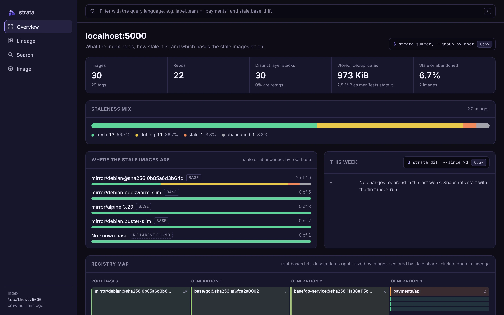

# Serving, API and MCP

`strata serve` serves the web UI, the JSON API and an MCP endpoint from one process, which becomes the only process that opens the index. CLI commands detect it and route through it.

```sh
strata ui                            # the web UI for your own index, on localhost only
strata serve                         # http://127.0.0.1:7878
strata serve --reindex-every 15m     # also re-crawl the configured registries
```

| Path | What |
| --- | --- |
| `/` | the web UI |
| `/v1/...` | the JSON API; see the [HTTP API reference](../reference/api.md) |
| `/openapi.json` | the OpenAPI spec the server was generated from |
| `/mcp` | a Model Context Protocol endpoint (streamable HTTP) |

The API is read-only: nothing in it can delete, tag or edit images. Requests are validated against the OpenAPI spec before any handler runs, so a bad parameter gets a 400 that names it.

## The web UI

The UI is built into the binary and reads the same JSON API, so there is nothing else to deploy. Every view is a URL you can bookmark or paste into a ticket, and each shows the `strata` command that gives the same answer.



Links work with a ref as well as a digest: `#image?d=reg.example.com/payments/api:1.8.2` resolves the tag and opens the image it points at.

| View | Shows |
| --- | --- |
| Overview | image, repo and storage totals, the staleness mix, the root bases holding the most stale images, the week's changes, and a registry map |
| Lineage | an outline of root bases, bases and repos with image counts and verdict bars. Each level loads when you expand it, and a repo pages through its images 50 at a time, so it stays fast at millions of images |
| Search | the query language in the top bar, facets for verdict, team, root base, platform and age whose counts update together, and paged results |
| Image | the verdict and its reasons, the ancestry chain, layers with the build step behind each, labels, config and findings |

The UI is read-only. It loads nothing from outside the server: fonts and scripts are embedded, and the page's content security policy allows only its own origin.

## Auth and shared mode

Bound to loopback (the default `127.0.0.1:7878`), the server needs no auth. On any other address it is in shared mode, and refuses to start unless you name a header your auth proxy sets on every request:

```sh
strata serve --addr :8080 --auth-header X-Forwarded-User
```

Requests without that header get a 401; this covers the UI, the API and `/mcp`. Put the server behind an authenticating proxy (oauth2-proxy, an ingress with OIDC, Cloudflare Access) that strips the header from client requests and sets it itself. The lineage graph maps your attack surface, so strata never serves it unauthenticated beyond localhost.

## One owner of the index

DuckDB allows one writing process per file. While `strata serve` runs, the read commands (`explain`, `ancestry`, `descendants`, `query`, `stale`, `roots`, `summary`) find the locked file, check for a server on `serve.addr`, and send their query to it. To point commands at a server elsewhere:

```sh
strata stale --server https://strata.internal.example.com
# or: export STRATA_SERVE_URL=https://strata.internal.example.com
```

Commands that write (`index`, `refresh`, `history import`) need the file itself; with a server running, let it re-crawl with `--reindex-every` instead.

## MCP for agents

The MCP server offers six read-only tools: `explain`, `ancestry`, `descendants`, `query`, `stale` and `roots`. The `query` tool's description includes the filter language, so an agent can answer questions such as "which prod images are on an EOL base?" directly.

Over stdio, for Claude Code and other local clients:

```sh
claude mcp add strata -- strata mcp --db /path/to/strata.duckdb
```

Over HTTP, point the client at `http://127.0.0.1:7878/mcp` while `strata serve` runs. In shared mode the auth header applies to `/mcp` as well.

## The Go client

`github.com/rossedman/strata/pkg/client` is a typed client generated from the same spec:

```go
c, err := client.NewClientWithResponses("http://127.0.0.1:7878")
if err != nil {
	return err
}
filter := `label.team = "payments" and stale = "stale"`
res, err := c.RunQueryWithResponse(ctx, &client.RunQueryParams{Filter: &filter})
```
